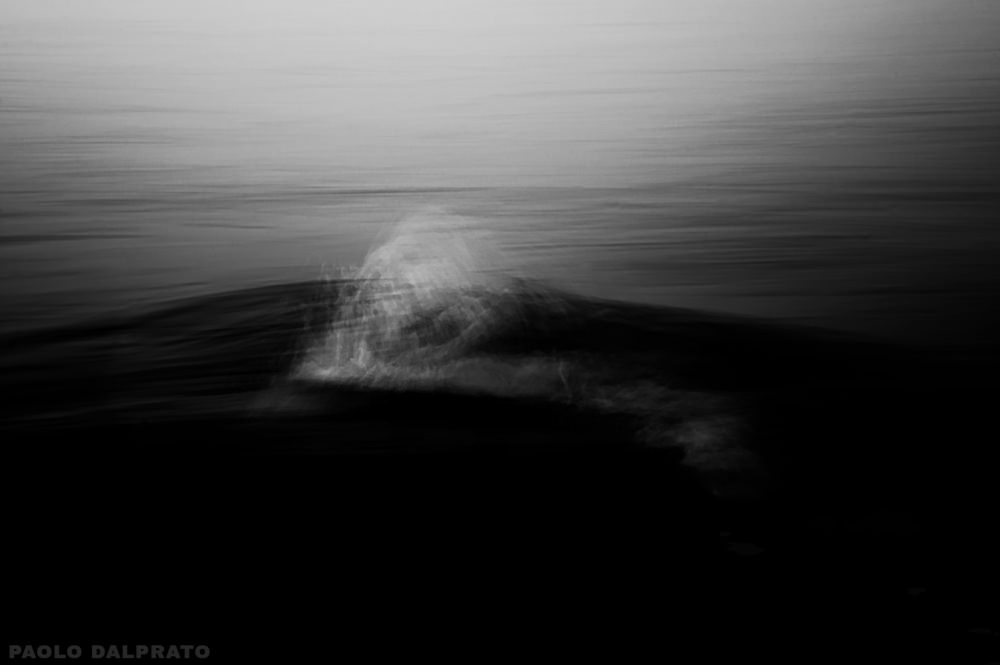

# Portfolio Analysis

Portfolio Analysis is a custom AI skill for reading a photographic portfolio through a guided dialogue with its author. It examines individual photographs, their relationships, and the collection as a whole, then delivers an illustrated critical PDF.

The skill covers photographic portfolios, series, and collections. Its source instructions and repository documentation are in English. Reports follow the language of the request or conversation, with English as the fallback.

## What it does

Portfolio Analysis develops a reading at three connected levels:

- **Individual photographs.** It examines composition, light, tonal relationships, color, space, movement, and visible technical qualities. Each reading explains what the photograph communicates and what it contributes to the collection.
- **Relationships.** It compares photographs through recurring forms, differences, tensions, and shifts in intensity. It identifies apparent dissonances and considers whether they broaden the collection's expression or weaken its integration.
- **The whole.** It develops an autonomous evaluation of the collection's visual language, proposed experience, expressive effectiveness, and unresolved tensions. This synthesis goes beyond a summary of separate image reviews.

An intentional sequence receives specific attention. An unordered collection is read through its relationships without assigning narrative meaning to attachment order.

The analysis reads the photographs as presented. Unsolicited retouching, cropping, reordering, exclusions, and additions are outside the default workflow. Changes to the selection initiated by the author are accepted and lead to a reassessment of the current collection.

## How it works

1. **Establish the collection.** The assistant checks access to every photograph, creates stable identifiers, and establishes whether the author has chosen a sequence.
2. **Read the photographs.** It develops an initial reading of the individual images, their relationships, and the whole. It uses context already supplied and distinguishes that context from visible evidence.
3. **Guide the exchange.** It asks focused questions when the answers can affect the reading. Each response leads to further analysis and relevant follow-up, including reasoned disagreement where the images support it.
4. **Consolidate the evaluation.** It considers the relationship between declared intent and the experience supported by the photographs. The exchange concludes when material questions have been addressed, or within the scope requested by the author.
5. **Produce and review the PDF.** It writes a self-contained report, reproduces the current selection, and inspects every rendered page before delivery.

There is no fixed questionnaire or number of turns. The PDF comes at the end of the substantive exchange. If the author requests a reading without further context, the report states the relevant limits.

Each report uses "Portfolio Analysis" as its heading and metadata title. Every page carries the footer "PORTFOLIO ANALYSIS by Paolo Dalprato". A supplied project title and photograph credits appear separately.

The PDF includes an overview of the collection, larger reproductions with individual readings, explicit comparisons, and a developed evaluation of the whole. Sequence analysis and verified artistic references appear when relevant. Photographs are shown whole, with preserved proportions. The final report presents the consolidated analysis without recounting the conversation or earlier selections.

## Example: Dark Waters



*Photograph copyright Paolo Dalprato. All rights reserved. Photographs are excluded from the MIT license.*

"Dark Waters" contains ten black-and-white photographs of the sea, without an intentional sequence. The project originated in reports of migrant shipwrecks in the Mediterranean. Its declared expressive aim concerns the imagined perception of a person alone in the water as evening advances.

The report considers how dark masses, partial visibility, changing surfaces, and the absence of stable spatial references can suggest exposure and fragility. It also examines the tension between the beauty of the visual structures and identification with a vulnerable position. The photographs support a perceptual reading; the report does not present them as a reconstruction of a particular shipwreck.

[Read the complete illustrated report in English](examples/portfolio-analysis-project-dark-waters.pdf) (23 pages).

The example is an English translation of the Italian report supplied for this repository. It retains the complete photographs and their placement. It illustrates the analytical approach and report format; it is not a new execution test of the revised skill. [Example provenance and image rights](examples/README.md) describe the included files.

<details>
<summary>Excerpt from the evaluation of the whole</summary>

The following passage comes from page 23 of the translated report.

> The whole is coherent because light, darkness, movement, and proximity contribute to the same perceptual problem. Differences in intensity broaden the register: continuous flow and reduced luminous presence accompany more evident disintegration. These variations make both the pressure of matter and the limits of available information perceptible. Instability and fragility acquire meaning through the relationship between dominant matter and an individual's vulnerable position.
>
> A tension remains between the force of identification and the beauty of the structures. Tonal balance, curves, and the texture of foam can sustain attention to form. Context instead invites those same forms to be considered from an exposed, vulnerable position. The two readings can coexist; the collection alone does not determine how far the viewer will maintain aesthetic distance or try to imagine themselves within that field.

</details>

## Requirements

The host must support custom skills, visual inspection of uploaded or accessible photographs, and file creation. Full delivery also requires PDF generation and page rendering. This repository contains instructions rather than an application or a bundled PDF engine; the host supplies those capabilities.

Approximately 10 to 20 photographs is a useful starting size, rather than a technical limit. Larger collections may require batches. Access, file size, and conversation limits depend on the host. Any incomplete coverage must be identified explicitly.

If PDF creation is unavailable, the assistant provides the complete analysis in the conversation and explains the limitation. If rendering is unavailable, it must state that the PDF has not been visually verified.

## Installation

The [installation ZIP](portfolio-analysis-skill.zip) contains one `portfolio-analysis` folder with `SKILL.md` and `LICENSE`. It excludes the example report and all photographs.

### OpenAI desktop app (Codex and ChatGPT)

The following steps install Portfolio Analysis as a local skill on your computer. Local skills are selected with `$` in both the Codex and ChatGPT sections of the OpenAI desktop app.

1. Download and extract `portfolio-analysis-skill.zip`.
2. Place its `portfolio-analysis` folder in the user skill directory, `~/.agents/skills/`. On Windows this is normally `%USERPROFILE%\.agents\skills\`. Create the skills directory if it does not exist.
3. Start a new conversation in either the Codex or ChatGPT section of the OpenAI desktop app. Type `$portfolio-analysis` and select Portfolio Analysis from the skill picker.
4. Attach the photographs or an accessible portfolio PDF and request a portfolio reading.

The installed file should be at `~/.agents/skills/portfolio-analysis/SKILL.md`. If the skill does not appear after installation, restart the application.

Codex CLI (the command-line interface) and IDE (integrated development environment) extensions also support local skills, selected with `$` or `/skills`. A Codex project can instead keep the folder under `.agents/skills/` for use in that project. See the [OpenAI skill documentation](https://learn.chatgpt.com/docs/build-skills) for current discovery rules.

Example request:

```text
$portfolio-analysis Read this photographic collection with me and produce the final report in English. The images have no intentional sequence.
```

Account skills are selected with `@` and require an account-level installation, such as through a plugin containing the skill. Copying the folder into `.agents/skills` installs the local skill only. See [OpenAI's skill distribution documentation](https://learn.chatgpt.com/docs/enterprise/skills) for these separate installation models.

### Claude

1. Enable code execution and file creation in the account's capabilities settings, where available.
2. Open **Customize > Skills**, choose **+ > + Create skill**, and select **Upload a skill**.
3. Upload `portfolio-analysis-skill.zip` intact and enable the skill.
4. Start a conversation, attach the photographs, and ask for a guided portfolio reading.

This is an account upload, separate from Claude's local directory installation. Organization settings may restrict custom skills. See [Use skills in Claude](https://support.claude.com/en/articles/12512180-use-skills-in-claude) and [How to create custom skills](https://support.claude.com/en/articles/12512198-how-to-create-custom-skills) for current requirements.

### Verify, update, or remove an installation

After installation, use a small photographic collection with a stated sequence status. Check that the assistant addresses individual images, develops comparisons, and guides the exchange before producing the PDF. Check the final report's image coverage, proportions, readability, and footer.

To update a local installation, replace its `SKILL.md` and `LICENSE` with the current files. For an uploaded installation, use the host's replacement or removal controls and upload the current ZIP. To remove a local installation, remove the installed `portfolio-analysis` folder. Repository and archive checks do not establish that the skill behaves identically across hosts.

## Repository structure

```text
portfolio-analysis/
  .gitattributes
  SKILL.md
  README.md
  LICENSE
  portfolio-analysis-skill.zip
  examples/
    README.md
    dark-waters-photograph-06.jpeg
    portfolio-analysis-project-dark-waters.pdf
```

[SKILL.md](SKILL.md) is the authoritative workflow. The ZIP packages the same instructions and license for installation. Example assets support the documentation and are not required at runtime.

## Scope and limits

Portfolio Analysis covers photography. Graphic design, illustration, charts, and technical diagrams are outside its scope. A single photograph does not support an evaluation of portfolio relationships; Visual Analysis is the companion project for an in-depth reading of one aesthetic image.

The assistant grounds interpretations in visible evidence and distinguishes them from author-supplied context. It should not invent intentions, locations, dates, camera settings, professional credentials, or direct artistic influences. Low resolution and compression can limit the reading of the supplied files.

The skill provides critical interpretation rather than grades or rankings. Its instructions require independent judgment, but output quality depends on the model, the accessible material, and the host's tools. Human review remains part of assessing a report.

## Contributions

Suggested changes should explain the photographic or workflow problem they address. Useful checks include unordered collections, intentional sequences, context already supplied, author-initiated replacements, incomplete access, and reports produced in different languages.

When changing the instructions, keep the repository's `SKILL.md` and installation ZIP consistent. Examples should identify their provenance and image rights.

## License

The skill instructions and text documentation are released under the [MIT license](LICENSE). All photographs, including those embedded in the example PDF, are copyright Paolo Dalprato and are excluded from MIT. Reusing the photographs requires separate permission from Paolo Dalprato.

## Authors

- Author: Paolo Dalprato.
- Co-author: GPT-6.1 Sol (OpenAI), for the development of the analytical workflow, instructions, and distribution package in collaboration with Paolo Dalprato.
